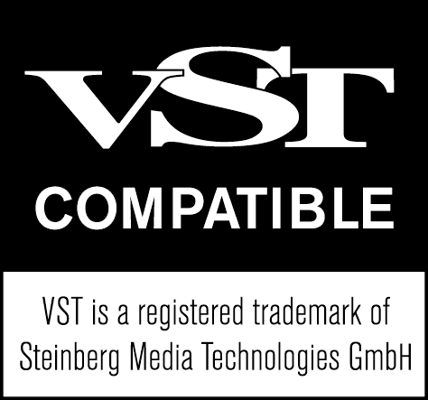

<!-- SPDX-License-Identifier: AGPL-3.0-or-later -->
# Confluence



**Générateur d'accords libre et gratuit (plugin VST® 3, macOS et Windows)** : une seule note jouée (clavier, contrôleur MIDI ou clip)
devient un accord complet, dans la gamme choisie, envoyé en MIDI à un autre instrument (synthé VST, Wavetable, Drift...).
Même univers visuel que Flow Filter et Undertow.

Une création du label et collectif **GRVTY Records**, développée par Jasperr.
Logiciel libre © 2026 GRVTY Records, sous licence [GNU AGPL v3 ou ultérieure](LICENSE), avec les termes additionnels
de [NOTICE](NOTICE). VST is a registered trademark of Steinberg Media Technologies GmbH.

> **English** — Confluence, by the GRVTY Records label and collective, is a free, open-source chord generator
> (VST® 3 instrument with MIDI output, macOS and Windows) for Ableton Live
> and other VST3 hosts: play one note, get a full chord in the chosen scale, sent as MIDI to any synth. The interface
> and documentation are in French. Licensed under AGPL-3.0-or-later; no data collection, no network access.
> See [CONTRIBUTING.md](CONTRIBUTING.md), [SECURITY.md](SECURITY.md) and [THIRD-PARTY-NOTICES.md](THIRD-PARTY-NOTICES.md).

## Installer

Dans les Releases du dépôt :
- **Mac** : `Confluence-v<version>-macOS.zip`, puis suis `LISEZMOI.txt` (installeur `.pkg`, macOS 11+, Apple Silicon
  et Intel) ;
- **Windows** : `Confluence-v<version>-Windows-setup.exe` (Windows 10 ou 11, 64 bits). Le plugin s'installe dans
  `C:\Program Files\Common Files\VST3`.

Vérifie le fichier téléchargé avec `SHA256SUMS.txt`. Dans Ableton, active « Use VST3 Plug-in System Folders » puis
Rescan : Confluence apparaît dans **Plug-Ins > VST3 > GRVTY Records**.

**Pour le brancher dans Ableton : voir [ROUTAGE-ABLETON.md](ROUTAGE-ABLETON.md).**
Pas de version AU : Ableton ne récupère pas la sortie MIDI d'un Audio Unit.

## Licence, garantie, confidentialité

- **Licence** : tu peux utiliser, étudier, modifier et redistribuer Confluence selon les termes de la GNU AGPL v3
  ou ultérieure ([LICENSE](LICENSE)). Une version modifiée que tu distribues reste sous cette licence, avec son code
  source, et porte un autre nom ; aucun droit de marque n'est accordé sur « GRVTY Records », « Jasperr », le nom du
  plugin ni son logo
  (termes additionnels de l'article 7 : [NOTICE](NOTICE)).
- **Ta musique t'appartient** : aucune licence, aucun crédit, aucune redevance pour les morceaux faits avec Confluence,
  y compris en usage commercial.
- **Aucune garantie** : Confluence est fourni « tel quel », dans les limites permises par la loi.
- **Confidentialité** : aucune donnée collectée, aucun accès à Internet, aucune mise à jour automatique.
  Le plugin n'écrit que tes presets, tes exports MIDI et un fichier MIDI temporaire pour le glisser-déposer
  (détails dans [SECURITY.md](SECURITY.md)).
- **Composants tiers** : JUCE 8.0.12 (GNU AGPL v3), SDK VST 3.8.0 de Steinberg (MIT) et leurs dépendances :
  [THIRD-PARTY-NOTICES.md](THIRD-PARTY-NOTICES.md).
- Le bouton **ⓘ** en haut à droite du plugin affiche ces informations.

## Les 4 modes

| Mode | Ce que fait la note jouée |
|---|---|
| **Gamme** | Ramenée dans la gamme (hors gamme : la plus proche, au-dessus, en dessous, ou ignorée), puis accord empilé avec les notes de la gamme. Toujours dans la tonalité. |
| **Touches blanches** | Do, Ré, Mi... Si = degrés I à VII de la gamme choisie, quelle que soit la tonique. Les touches noires jouent une variante du degré de la touche blanche juste en dessous (C# = I, D# = II, F# = IV, G# = V, A# = VI) : Sus4, Sus2, 9e, accord emprunté au mode parallèle, ou muettes. Gammes de 5 ou 6 notes : les degrés suivants repartent à l'octave. |
| **Accord fixe** | Une forme (m9, maj7, stab mineur...) transposée chromatiquement sur la note jouée. **LEARN** : joue un accord (touches ensemble), relâche, il devient la forme « Appris ». Rien d'appris : accord mineur. |
| **Pads** | 8 notes consécutives à partir de « Note pad 1 » (C1 par défaut, comme les pads de Push) déclenchent 8 accords réglables (degré, type, renversement, octave : clic droit sur un pad). **GÉNÉRER** remplit les 8 pads selon le style. |

## Voicing et jeu

- Types : quinte, triade, sus2, sus4, 6, 7, 9, add9, 11, 13, quartes, cluster.
- Renversement 0 à 3, ou **Auto** (voice leading : le renversement qui bouge le moins depuis l'accord précédent).
- Écartement : serré, ouvert, drop 2, drop 3, large (2 octaves). Voix max (2 à 8, la basse en plus).
- Notes la plus basse / la plus haute : l'accord est replié à l'octave dans cette plage (la basse n'en tient pas compte).
- Basse : fondamentale une ou deux octaves sous l'accord. Octave et transposition globales
  (la transposition change la tonalité de sortie).
- Strum (0-200 ms ou synchro tempo), vers le haut, le bas, alterné, aléatoire. Humanize : retard (jamais d'avance) et velocity.
- Velocity : suit la touche, fixe, ou courbe ; équilibre basse / milieu / aigu.
- Durée : tenue (suit la touche) ou fixe et synchro (1/32 à 1/1) pour les stabs. Latch : l'accord reste jusqu'à la note suivante.
- CC, pitch bend, aftertouch et sustain passent tels quels (recopiés sur le canal de sortie).

## Gammes

17 gammes, chacune avec son ambiance : majeur, mineur naturel, dorien, phrygien, phrygien dominant, mineur harmonique,
mineur mélodique, lydien, mixolydien, locrien, pentatoniques mineure et majeure, blues, mineure hongroise,
double harmonique, hirajoshi, chromatique.

Le plugin propose des gammes de trois façons : **par style** (3 gammes conseillées), **par détection** (ANALYSER, joue quelques
mesures ou lance le clip, puis clique sur une des 3 propositions) et **par enchaînement** (les degrés qui vont bien après
l'accord joué sont affichés).

## Export MIDI

- Pilule **MIDI 4** (au-dessus des pads) : glisse-la dans une piste d'Ableton, la progression des 8 pads devient un clip de 4 mesures.
- Clic sur la pilule : menu 4 ou 8 mesures, export d'un fichier `.mid` dans `Musique / Confluence`, ouvrir le dossier.

## Interface (disposition C « Courant », 1000 x 470, redimensionnable)

- En haut : navigateur de presets (banques, flèches, menu), **SAVE**, dossier des presets, dé, **PANIC**, version et bouton **ⓘ** (À propos).
- À gauche : mode, tonique, gamme, style ; les 3 gammes du style (un clic les applique) ou, avec **ANALYSER**,
  les 3 gammes détectées ; le tourbillon des enchaînements (cercle des quintes : accord joué en corail,
  degrés conseillés en courants pointillés).
- Au centre : onglets **CHORD / VOICING / PLAY**, puis la mer : le nom de l'accord et son degré en surface,
  les notes qui montent en bulles, le clavier sous l'eau (notes de la gamme éclairées, tonique entourée, jouable à la souris).
- À droite : les 8 pads (pad 1 en bas à gauche, comme sur Push), **GÉNÉRER** et la pilule MIDI.

## Presets

Presets d'usine en 3 banques (DEEP & HOUSE, HYPNOTIC & DUB, TECH HOUSE & STABS) : réglages + 8 pads (+ accord appris).
Un preset ne touche jamais au canal de sortie, à la voix Preview ni à la note du pad 1 (tes réglages de routage).
Presets utilisateur : **SAVE**, fichiers `.cfpreset` dans `Bibliothèque / Audio / Presets / GRVTY Records / Confluence`
sur Mac (les presets de l'ancien dossier « Jasperr » y sont recopiés) et `Documents\GRVTY Records\Confluence\Presets`
sur Windows.
Pour chaque preset d'usine, le banc de tests écrit un `.mid` de 4 mesures (sortie MIDI du plugin) et un WAV joué par la
voix Preview (`build-linux/renders/presets/`).

## Fichiers

| Fichier | Rôle |
|---|---|
| `Source/Params.h` | Tous les paramètres (IDs figés depuis la phase 1) |
| `Source/theory/Theory.h` | Gammes, quantification, construction des accords, noms et degrés |
| `Source/theory/Voicing.h` | Limite de voix, renversements, voice leading, écartements, plage, basse |
| `Source/theory/Harmony.h` | Gammes par style, détection de la gamme, enchaînements, générateur de pads |
| `Source/engine/Resolver.h` | Les 4 modes : de la note jouée à l'accord |
| `Source/engine/MidiEngine.h` | Moteur MIDI temps réel : strum, durées, latch, notes partagées, coupures |
| `Source/engine/PreviewSynth.h` | Voix Preview |
| `Source/engine/TripleBuffer.h` | Échange sans verrou interface <-> audio |
| `Source/MidiExport.h` | Clip MIDI de la progression des pads |
| `Source/PluginProcessor.*` | Paramètres, transport, Learn, analyse, état |
| `Source/PresetManager.*`, `Source/presets/FactoryPresets.h` | Presets d'usine et utilisateur, dé |
| `Source/PluginEditor.*` | Fenêtre : disposition C, onglets, fond animé |
| `Source/ui/LiquidUI.*` | Look « eau » repris de Flow Filter et d'Undertow |
| `Source/ui/SeaView.*` | La mer : nom de l'accord, bulles, clavier sous l'eau |
| `Source/ui/Whirlpool.*` | Tourbillon des enchaînements |
| `Source/ui/PadGrid.*` | Les 8 pads, GÉNÉRER, pilule MIDI |
| `Source/ui/PresetBar.*` | Navigateur de presets |
| `Source/ui/AboutPanel.*` | Bouton ⓘ et panneau « À propos » (licence, code source, confidentialité, marques) |
| `release.command`, `packaging/mac/` | Version publiable Mac : installeur `.pkg`, archives, empreintes |
| `packaging/windows/` | Version Windows : script de compilation, installeur NSIS (`.exe`), LISEZMOI |
| `.github/workflows/build.yml` | Compilation automatique (tests Linux, Windows, Mac, Release brouillon) |
| `LICENSE`, `NOTICE`, `THIRD-PARTY-NOTICES.md` | Licence AGPL v3, termes additionnels, composants tiers |
| `docs/images/` | Logo officiel VST Compatible de Steinberg (marque de Steinberg, hors licence AGPL) |
| `tests/ConfluenceTests.cpp` | Banc de tests |

## Compiler depuis les sources

**Mac (développement)** : double-clique sur `build.command`. Le script :
1. trouve Xcode, CMake et JUCE 8 (`~/Documents/JUCE`, sinon téléchargé) ;
2. incrémente le numéro de build (version affichée en haut à droite du plugin) ;
3. supprime l'ancienne version installée, compile le VST3 et l'installe dans `~/Library/Audio/Plug-Ins/VST3` ;
4. valide le plugin avec pluginval (strict, niveau 10).

Tout est écrit dans `build.log` : chercher `TERMINE`, `Built target` et `PLUGINVAL ... SUCCESS`.

**Mac (version publiable)** : `release.command` compile une version universelle avec JUCE 8.0.12, fabrique l'installeur
`.pkg`, les archives du code source (Confluence et JUCE) et les empreintes SHA-256 dans `dist/` (signature et
notarisation Apple si configurées). Il refuse de travailler sur des modifications non enregistrées dans git.

**Windows** : dans Git Bash, avec Visual Studio 2022 ou plus récent (« Développement Desktop en C++ »), CMake et NSIS 3 :
`bash packaging/windows/build-windows.sh`. Il compile le VST3 64 bits, le valide avec pluginval et fabrique
`dist/Confluence-v<version>-Windows-setup.exe`.

**Compilation automatique** : à chaque envoi sur GitHub, [`.github/workflows/build.yml`](.github/workflows/build.yml)
lance le banc de tests (Linux) et fabrique l'installeur Windows et la version Mac ; à chaque tag `v1.0.x`, il prépare
une Release brouillon avec tous les fichiers.

**Autres options CMake** : `-DCF_SOURCE_URL=<adresse du dépôt>` (affichée dans le panneau ⓘ),
`-DCF_INSTALL_AFTER_BUILD=OFF` (ne pas copier le plugin après la compilation), `-DJUCE_PATH=<dossier JUCE 8>`.

## Banc de tests (Linux)

Paquets nécessaires (Debian / Ubuntu) : `cmake ninja-build g++ libasound2-dev libfreetype-dev libfontconfig1-dev
libx11-dev libxcomposite-dev libxcursor-dev libxext-dev libxinerama-dev libxrandr-dev libxrender-dev`
(et `xvfb` pour lancer pluginval sans écran).

```bash
cmake -B build-linux -G Ninja -DCMAKE_BUILD_TYPE=Release -DCF_BUILD_TESTS=ON   # JUCE 8.0.12 téléchargé, ou -DJUCE_PATH=...
ninja -C build-linux ConfluenceTests Confluence_VST3
cd build-linux && ./ConfluenceTests_artefacts/Release/ConfluenceTests          # tout
./ConfluenceTests_artefacts/Release/ConfluenceTests fuzz    # un seul groupe : theory, names, scale, voicing, detect, modes,
                                                            # midi, offs, fuzz, state, hostile, perf, presets, snap
./ConfluenceTests_artefacts/Release/ConfluenceTests uiprof  # coût de dessin de chaque partie de l'interface
```

## Contribuer, sécurité, historique

- Contributions : [CONTRIBUTING.md](CONTRIBUTING.md) (licence AGPL, signature `git commit -s`, banc de tests complet).
- Faille de sécurité : signalement privé, voir [SECURITY.md](SECURITY.md).
- Versions : [CHANGELOG.md](CHANGELOG.md).

## Marques

VST est une marque déposée de Steinberg Media Technologies GmbH. Ableton, Live et Push sont des marques d'Ableton AG.
Mac et macOS sont des marques d'Apple Inc. Confluence n'est affilié à aucune de ces sociétés, ni approuvé par elles.
